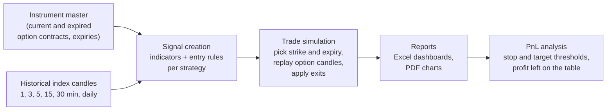

# backtest_upstox — Python backtesting of intraday Nifty and BankNifty option strategies

> **Status: personal project, not maintained.** Built in 2024–2026 for the author's own trading research. The companion live-trading component stopped working after the broker changed its API security and new regulatory requirements took effect, and has been retired. The backtesting code is kept here as a record of the work. It is not investment advice and not production code.

The project tests rule-based intraday option-buying strategies on the Nifty 50 and Bank Nifty indices. It pulls historical candles and option-contract data from the [Upstox](https://upstox.com/developer/api-documentation/) broker API, turns each strategy's rules into entry and exit signals, simulates the resulting option trades minute by minute, and produces Excel and PDF reports on how each strategy would have performed. It runs as a container, with a GitHub Actions pipeline that lints, scans for secrets and vulnerabilities, and builds the image.

## How it works



1. **Instrument data.** Downloads the exchange instrument master and, for past periods, the expired option contracts and expiry dates for each index.
2. **Historical data.** Fetches index candles at several intervals and stores them as CSV files.
3. **Signals.** For each strategy, calculates indicators (EMA filters, ATR, an adaptive Gaussian moving average, ATR trailing stops) and marks the candles where its entry rules fire.
4. **Trades.** For each signal, selects the option strike (offset from the index price, adjusted near expiry) and the expiry, fetches that contract's minute candles, and replays the trade: lot sizing from the configured investment, exits by ATR stop, trailing stop, profit threshold or a fixed time, and slippage.
5. **Reports.** Produces per-signal, per-trade and aggregate results: realised PnL, win rate, maximum favourable and adverse excursion during each trade, with charts.
6. **Optimisation.** Studies the trade results to find better stop-loss and exit thresholds and how much profit time-based exits left behind.

## Strategies as configuration

Each strategy is a JSON file in `datafiles/Strategies/` (for example `NIFTY_S01.dat`), so a new variant needs no code change. A file sets the index, direction, candle interval, entry window and cut-off, strike offset and adjustment rules, indicator lengths and multipliers, exit and trailing-stop parameters, investment per trade and daily loss limit.

## Project layout

| Path | Contents |
|---|---|
| `upstox_core/data_creators/` | Upstox API wrappers for instruments, expiries and history; signal and trade data creation |
| `upstox_core/data_consumers/` | Market-data and portfolio streaming over WebSocket (protobuf feed), and order calls used by the retired live component |
| `backtest_common/` | Strategy base class and configuration loader, technical-indicator library, report generator, path settings |
| `test_client/` | Entry points: the backtest run and the PnL optimiser |
| `datafiles/Strategies/` | Strategy configuration files |
| `Dockerfile`, `docker-compose.yml` | Multi-stage image (build wheels, then a slim non-root runtime) and a local run definition |
| `.github/workflows/ci.yml` | Pipeline: flake8 lint, TruffleHog secret scan, image build, Trivy vulnerability scan |
| `terraform/` | Amazon ECR repository for the image |

## Technology

Python 3.14, pandas, NumPy, pandas-ta, Upstox Python SDK, WebSocket client with protobuf decoding, Matplotlib, XlsxWriter and openpyxl for Excel dashboards, ReportLab for PDF reports, PyYAML. Docker and Docker Compose, GitHub Actions, TruffleHog, Trivy, Terraform on AWS.

## Running it

An Upstox developer account and an access token are needed. The token is read from the environment variable `UPSTOX_ACCESS_TOKEN` and is never committed: copy `.env.sample` to `.env` (ignored by Git) and put the token there.

```powershell
Copy-Item .env.sample .env
# edit .env and set UPSTOX_ACCESS_TOKEN

docker compose up --build
```

Data, reports and logs are written to the local `datafiles/`, `logs/` and `misc/` folders, which are mounted into the container.

## Known limitations

- No automated tests.
- Settings and file paths live in Python modules rather than a settings file.
- Several experimental variants of the signal and trade classes remain alongside the main ones.
- Backtests ignore brokerage, taxes and liquidity beyond a simple slippage estimate, so live results would differ.
- The secret scan runs TruffleHog in its default verified-only mode, which cannot flag tokens it cannot verify as live.
